# Atividades

Plano para 6 sessões de 50 minutos, com um mediador para cada 10 alunos. As sessões podem ser presenciais ou com os alunos conectados de casa.

As imagens de cada missão são ilustrações do que a atividade propõe, não registros de sessões. Como gerá-las está em [IMAGENS_ATIVIDADES.md](IMAGENS_ATIVIDADES.md).

## Visão geral

| Sessão | Tema | Missões | Modalidade sugerida |
|---|---|---|---|
| 1 | Boas-vindas e circuitos lógicos | M0, T4.1 | Presencial |
| 2 | Portas lógicas | T4.2, T4.3 | Remota ou presencial |
| 3 | Fundamentos de computadores | T1.1, T1.2, T1.3 | Remota ou presencial |
| 4 | Internet e redes | T2.1, T2.2 | Remota ou presencial |
| 5 | Segurança digital | T2.3 e debate | Remota ou presencial |
| 6 | Produtividade e encerramento | T3.1, T3.2, T3.3 | Remota ou presencial |

## Roteiro de cada sessão

| Tempo | Etapa |
|---|---|
| 5 min | Entrada no servidor e combinados |
| 10 min | Explicação curta do mediador ou do NPC |
| 25 min | Missões no jogo |
| 10 min | Conversa: o que aprendemos e onde isso existe no mundo real? |

## M0 – Primeiros passos

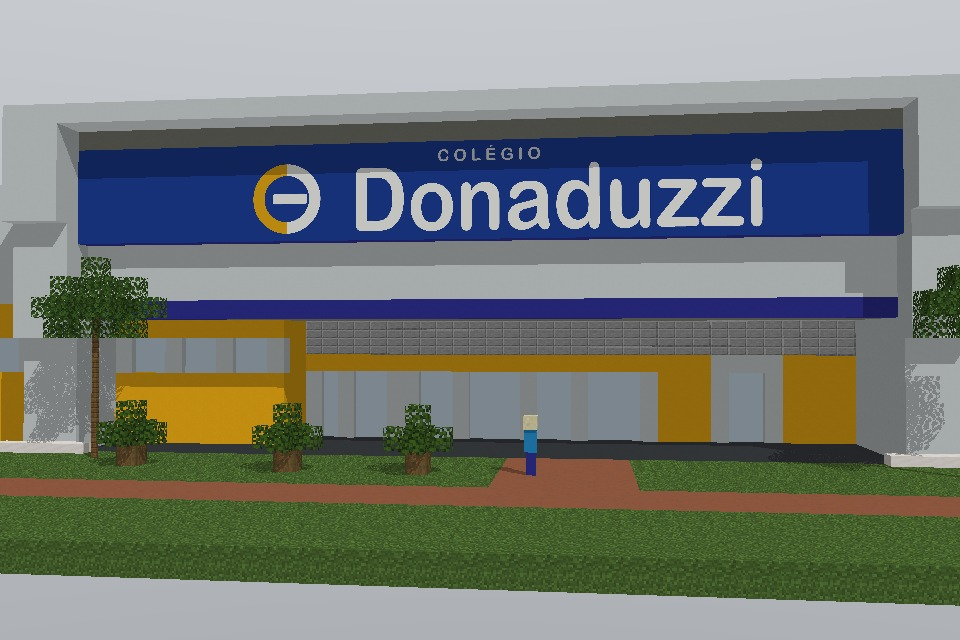
- **Objetivo:** aprender a se mover, falar com NPCs e ver as missões.
- **No jogo:** falar com Bia, ver `/quests` e chegar ao Painel de Circuitos.
- **Critério:** chegou ao painel.

## Trilha 1 – Fundamentos de Computadores e SO

### T1.1 Peças do computador

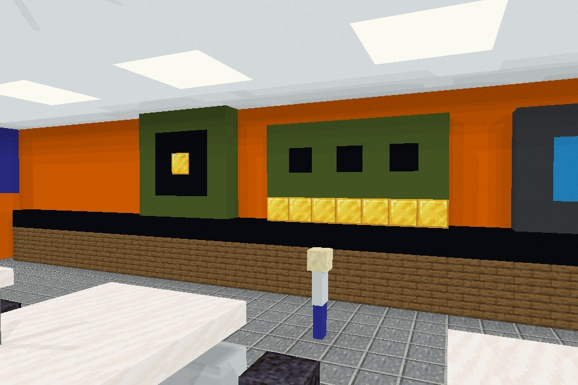
- **Objetivo:** reconhecer CPU, memória, armazenamento, entrada e saída.
- **No jogo:** visitar as estações do laboratório, cada uma com uma peça gigante.
- **Critério:** visitou todas as estações e explicou a função de uma peça.

### T1.2 Caminho da informação

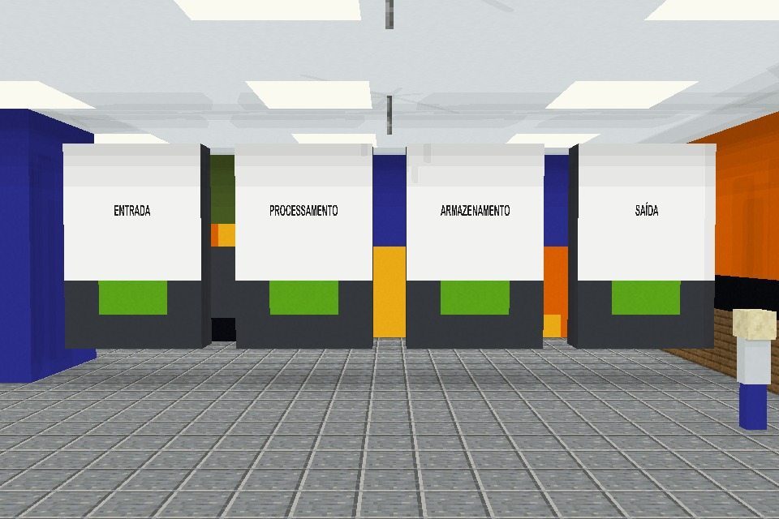
- **Objetivo:** entender entrada, processamento, armazenamento e saída.
- **No jogo:** ordenar as etapas pressionando botões na sequência correta.
- **Critério:** acertou a sequência.

### T1.3 O gerente da máquina

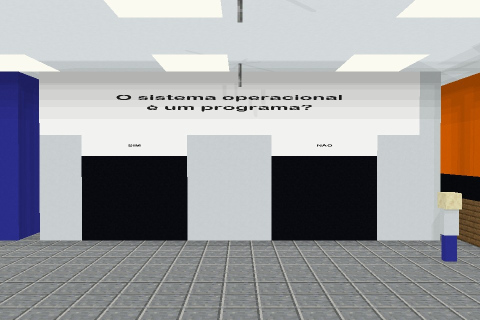
- **Objetivo:** entender o papel do sistema operacional.
- **No jogo:** responder ao questionário de portas sobre arquivos, pastas e programas.
- **Critério:** acertou ao menos 3 de 4 perguntas.

## Trilha 2 – Internet e Segurança Digital

### T2.1 Viagem do pacote

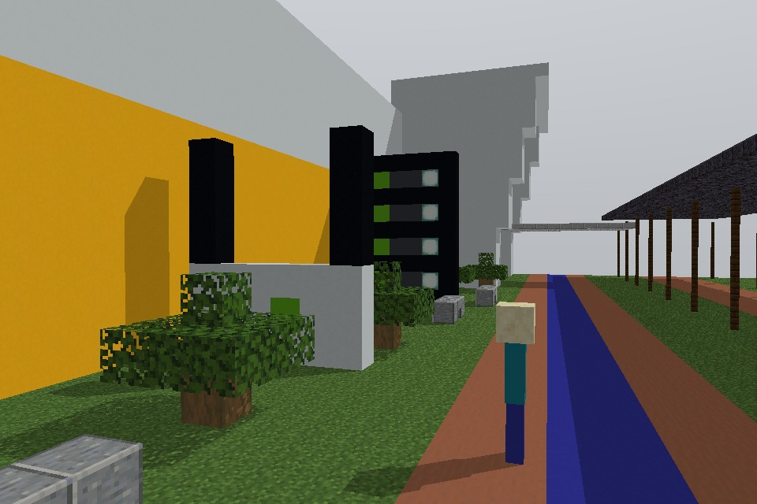
- **Objetivo:** entender computador, roteador, servidor e pacotes de dados.
- **No jogo:** percorrer a Rua das Redes, do "computador" ao "servidor".
- **Critério:** concluiu o percurso e explicou o que faz o roteador.

### T2.2 Senha forte

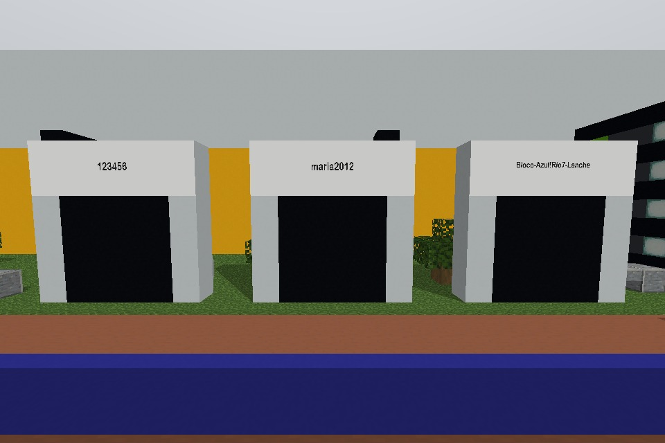
- **Objetivo:** identificar senhas fortes e fracas.
- **No jogo:** escolher, entre várias portas, a que tem a senha mais segura.
- **Critério:** escolheu corretamente.
- **Atenção:** nunca peça ao aluno que digite uma senha real.

### T2.3 Golpe ou verdade?

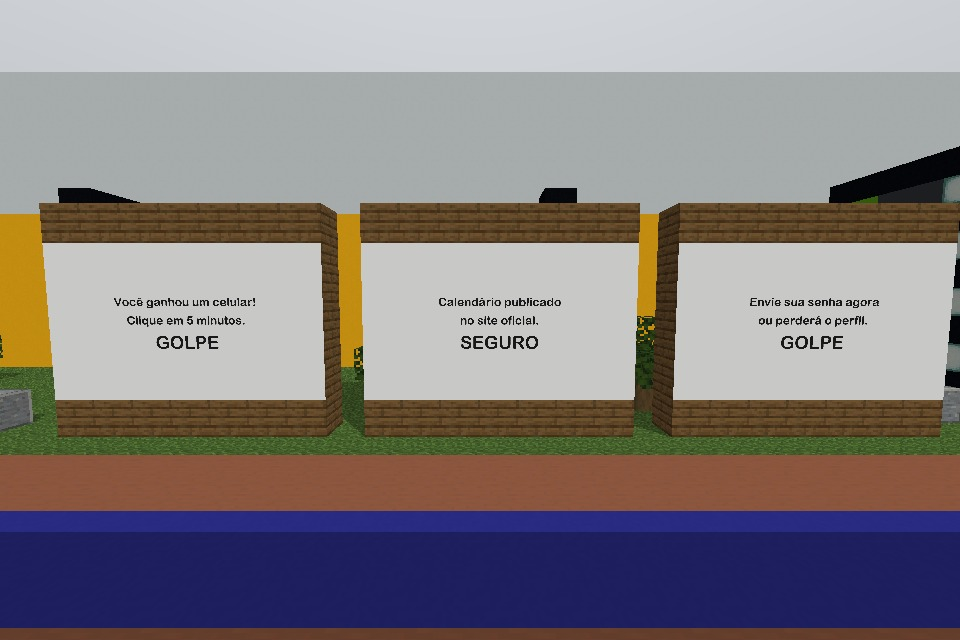
- **Objetivo:** reconhecer sinais de golpes e cuidar da privacidade.
- **No jogo:** classificar mensagens em placas como "golpe" ou "seguro".
- **Critério:** acertou ao menos 4 de 5 mensagens.

## Trilha 3 – Produtividade

### T3.1 Texto bem feito

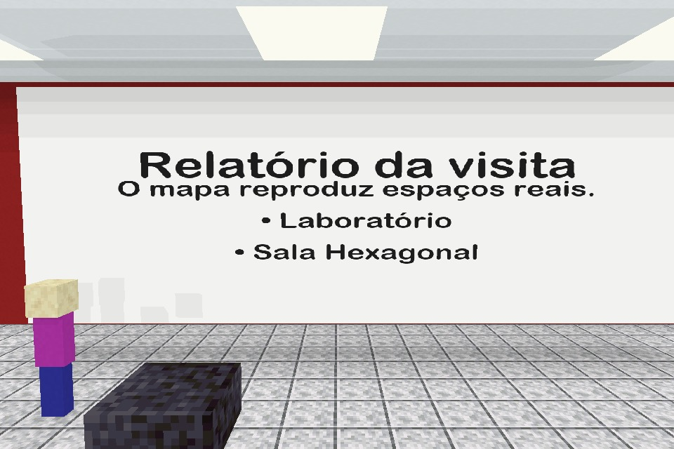
- **Objetivo:** usar títulos, listas e revisão.
- **No jogo:** coletar os elementos de um documento na ordem certa.
- **Fora do jogo:** escrever um relatório curto sobre a visita ao mapa.
- **Critério:** documento com título, parágrafo e lista.

### T3.2 Planilha de recursos

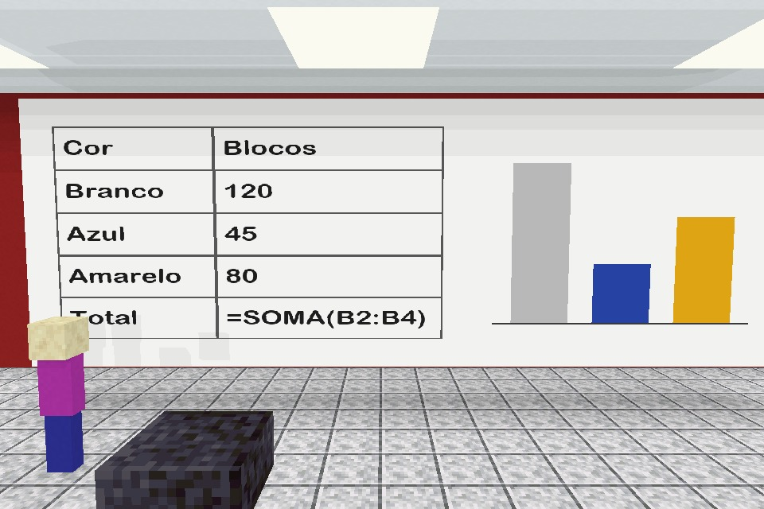
- **Objetivo:** usar células, somas e gráficos.
- **No jogo:** contar os blocos de uma construção.
- **Fora do jogo:** registrar os dados em planilha e usar a fórmula de soma.
- **Critério:** soma correta e um gráfico.

### T3.3 Apresentação do mapa

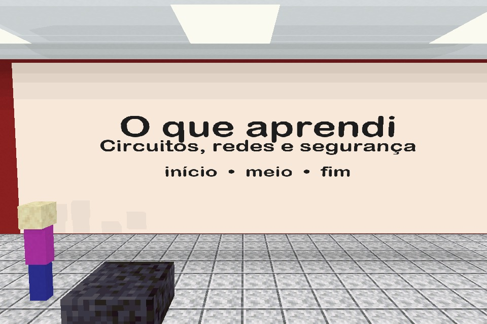
- **Objetivo:** organizar ideias em slides.
- **No jogo:** tirar uma captura de tela de uma construção sua ou do mapa.
- **Fora do jogo:** montar de 3 a 5 slides sobre o que aprendeu.
- **Critério:** apresentação com início, meio e fim.

## Trilha 4 – Circuitos Lógicos

### T4.1 Liga e desliga

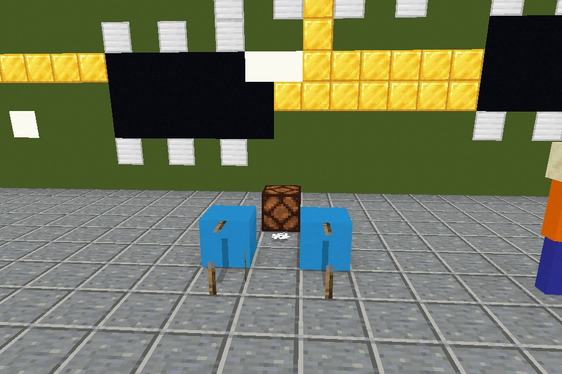
- **Objetivo:** entender entrada, saída e os estados ligado e desligado.
- **No jogo:** acionar uma alavanca e acender uma lâmpada.
- **Critério:** acendeu a lâmpada e explicou o que é entrada e saída.

### T4.2 As três portas

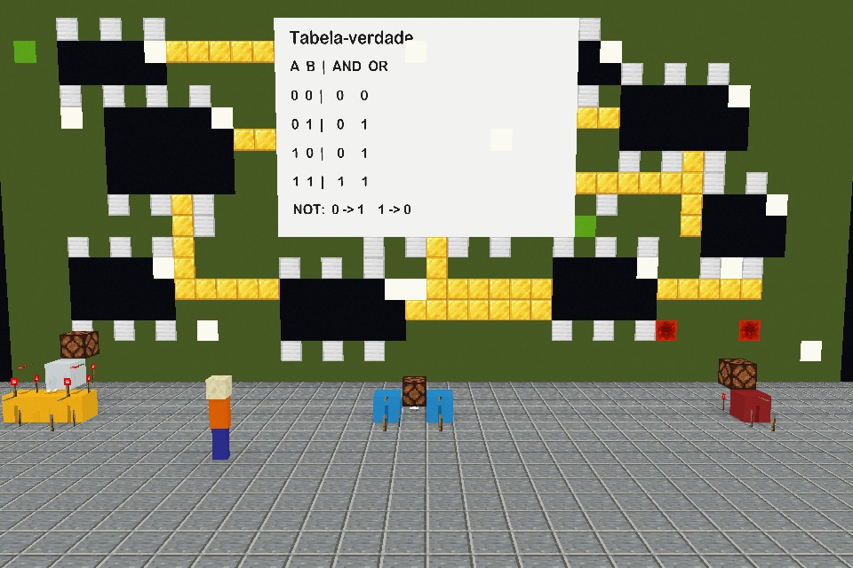
- **Objetivo:** reconhecer as portas AND, OR e NOT.
- **No jogo:** testar as três bancadas diante do painel gigante e completar a tabela-verdade.
- **Critério:** tabela-verdade correta.

| Porta | Entrada A | Entrada B | Lâmpada |
|---|---|---|---|
| AND | 0 | 0 | 0 |
| AND | 0 | 1 | 0 |
| AND | 1 | 0 | 0 |
| AND | 1 | 1 | 1 |
| OR | 0 | 0 | 0 |
| OR | 0 | 1 | 1 |
| OR | 1 | 0 | 1 |
| OR | 1 | 1 | 1 |
| NOT | 0 | – | 1 |
| NOT | 1 | – | 0 |

### T4.3 Construa seu circuito

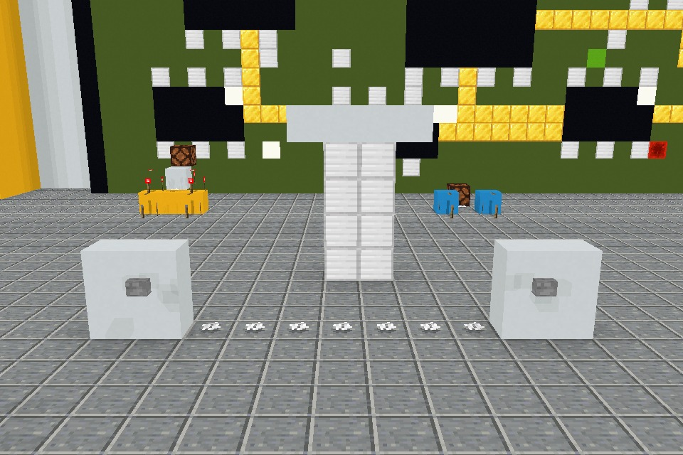
- **Objetivo:** aplicar uma porta lógica a um problema.
- **No jogo:** em dupla, montar nas bancadas livres uma porta que só abre com dois botões pressionados, ou uma luz controlada por dois interruptores.
- **Critério:** o circuito funciona e a dupla explica a porta usada.

## Adaptações

- **Sem conta Java:** formar duplas ou usar as máquinas do laboratório.
- **Internet instável:** fazer a parte fora do jogo e registrar a participação.
- **Daltonismo:** não depender só da cor. As bancadas e placas também trazem o nome da porta.
