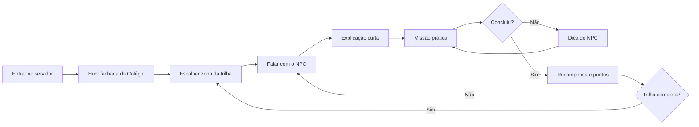
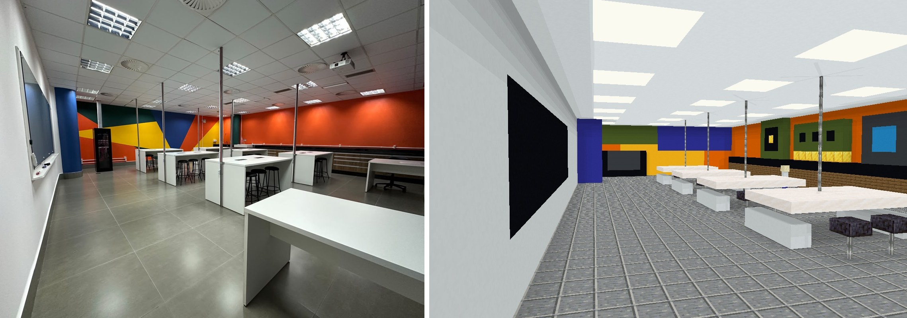
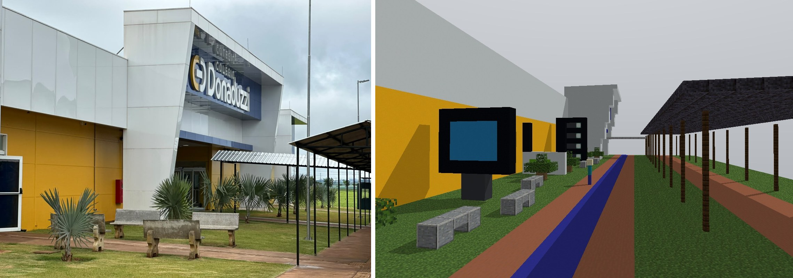
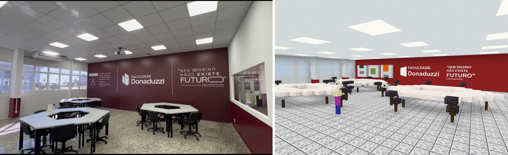
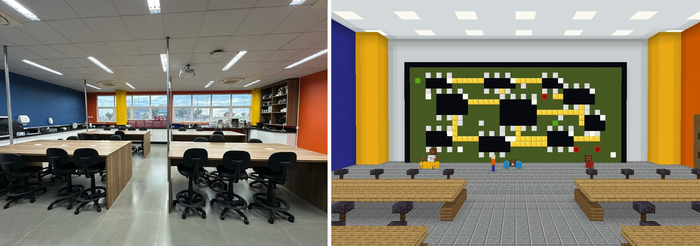
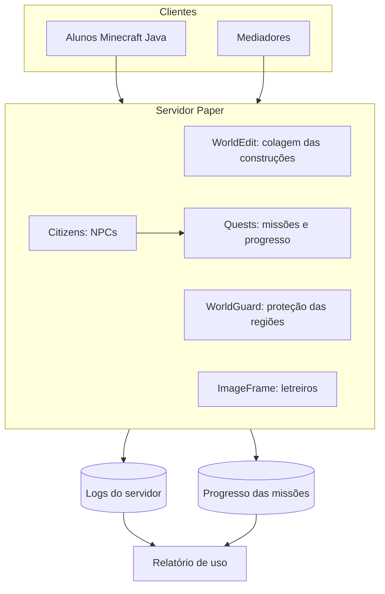

# Game Design Document

**Projeto:** Biopark Toledo no Minecraft: Informática que Joga
**Versão do documento:** 1.0
**Gênero:** servidor educacional cooperativo, com missões guiadas por NPCs
**Plataforma:** Minecraft Java Edition em servidor Paper

> O que já existe e o que falta construir está em [STATUS.md](STATUS.md). Este GDD descreve o jogo completo.

## 1. Visão

O aluno entra em uma versão em blocos do Biopark Toledo. Em cada zona, um NPC propõe uma missão. Para concluir, o aluno aplica um conceito de informática dentro do jogo e recebe retorno imediato.

### Objetivos pedagógicos

- Entender como um computador funciona, do hardware ao sistema operacional.
- Usar a internet com segurança e senso crítico.
- Praticar ferramentas de produtividade: texto, planilhas e apresentações.
- Desenvolver pensamento computacional com circuitos lógicos.

### Objetivos para os acadêmicos

- Praticar Game Design e Engenharia de Software em um projeto real.
- Elaborar e versionar um GDD.
- Atuar na mediação de aprendizagem com estudantes.

## 2. Público

| Grupo | Papel | Permissões no jogo |
|---|---|---|
| Estudantes da educação básica | Jogadores | Modo aventura; constroem só nas áreas de atividade |
| Acadêmicos | Mediadores e desenvolvedores | Modo criativo nas áreas de construção |
| Professores | Mediação e avaliação | Acompanham as sessões e aplicam as rubricas |
| Administrador | Operação do servidor | Acesso total |

## 3. Pilares de design

1. **Aprender fazendo:** toda explicação termina em uma ação no jogo.
2. **Lugar reconhecível:** o mapa reproduz espaços reais do Biopark e do Colégio.
3. **Retorno imediato:** a lâmpada acende, a porta abre, a missão avança.
4. **Falas curtas:** cada fala do NPC cabe em poucas linhas de chat.
5. **Ambiente seguro:** servidor fechado, sem PvP, sem dano e com lista de permissão.

## 4. Ciclo de jogo

## 5. Trilhas

| Trilha | Zona | NPC | Conteúdo | Diálogos |
|---|---|---|---|---|
| T1 Fundamentos de Computadores e SO | Laboratório de Hardware | Prof. Byte | Hardware, entrada e saída, memória, sistema operacional | [t1](../dialogos/t1_fundamentos.txt) |
| T2 Internet e Segurança Digital | Rua das Redes | Ana Rede | Redes, senhas, golpes, privacidade | [t2](../dialogos/t2_seguranca.txt) |
| T3 Produtividade | Sala Hexagonal | Duda Docs | Texto, planilhas, apresentações | [t3](../dialogos/t3_produtividade.txt) |
| T4 Circuitos Lógicos | Painel de Circuitos | Téo Circuito | Portas AND, OR e NOT, tabela-verdade | [t4](../dialogos/t4_circuitos.txt) |

O acolhimento fica em [t0_boas_vindas.txt](../dialogos/t0_boas_vindas.txt), com a NPC Bia.

Cada missão tem uma ilustração em [ATIVIDADES.md](ATIVIDADES.md). O script que gera as imagens está documentado em [IMAGENS_ATIVIDADES.md](IMAGENS_ATIVIDADES.md).

### Progressão

A missão M0 e as 3 missões de cada trilha somam 13 missões. O aluno pode escolher a ordem das trilhas, e o NPC orienta a sequência dentro de cada uma. Cada missão vale 1 ponto de missão (`quest-points`).

## 6. Mecânicas

| Mecânica | Como funciona | Ferramenta |
|---|---|---|
| Diálogo | Falar com o NPC inicia a missão | Citizens + Quests |
| Exploração | Chegar a um ponto do mapa conclui uma etapa | Quests |
| Quebra-cabeça de redstone | Alavancas e lâmpadas nas bancadas | Vanilla |
| Questionário | Portas com respostas certas e erradas | Redstone + regiões |
| Tarefa fora do jogo | Aluno faz a tarefa e o mediador valida | Rubrica |
| Área protegida | Impede que o mapa seja danificado | WorldGuard |

## 7. Mundo

O mapa é plano e cada zona corresponde a um espaço real ou temático. Detalhes e coordenadas de regiões estão em [MAPA_E_REGIOES.md](MAPA_E_REGIOES.md).

**Escala:** 1 bloco ≈ 0,6 m. Assim, o portal do Colégio Donaduzzi tem 48 × 18 blocos, e as portas têm 4 blocos de altura.

### Direção de arte

- Cores reais do prédio: branco (`white_concrete`), azul (`blue_concrete`) e amarelo (`yellow_concrete`).
- Móveis e objetos especiais são modelados no Blockbench, como mesas hexagonais, cadeiras, lixeira e estufa expositora.
- Imagens grandes, como letreiros, usam mapas em molduras por meio do ImageFrame.
- O mod de texturas é opcional para o aluno e distribuído como pacote de recursos.

### Imagens das zonas

Cada zona foi modelada a partir de uma foto real da instituição, de modo a ser reconhecível, sem buscar exatidão. As imagens abaixo são renderizações dos modelos, com a foto de referência à esquerda.

**T1 Laboratório de Hardware**

**T2 Rua das Redes**

**T3 Sala Hexagonal**

**T4 Painel de Circuitos**

## 8. Personagens

| NPC | Função | Tom |
|---|---|---|
| Bia | Recepção e orientação | Acolhedora |
| Prof. Byte | Hardware e sistema operacional | Curioso, usa comparações do dia a dia |
| Ana Rede | Internet e segurança | Direta, usa situações reais |
| Duda Docs | Produtividade | Prática e organizada |
| Téo Circuito | Circuitos lógicos; fica no painel gigante | Animado e experimental |

**Regra de escrita:** frases curtas, sem jargão sem explicação, com no máximo 4 falas antes de uma ação.

## 9. Interface

- Chat para as falas e instruções.
- `/quests` para ver as missões disponíveis.
- `/quest` para ver o objetivo atual.
- Placas nas zonas para indicar a direção.

## 10. Regras e segurança

- Lista de permissão ativa; só entra quem está cadastrado.
- Sem PvP, sem monstros e sem dano ambiental.
- Chat acompanhado por um mediador durante as sessões.
- Regras de convivência lidas no início da primeira sessão.
- Alunos usam apelidos, nunca o nome completo, no nome de jogador.
- Sessões remotas ocorrem somente com mediador conectado.

## 11. Avaliação

A avaliação combina conclusão de missões e rubrica do mediador. Veja [AVALIACAO_E_EVIDENCIAS.md](AVALIACAO_E_EVIDENCIAS.md).

| Indicador | Meta do projeto |
|---|---|
| Trilhas/áreas liberadas | 4 |
| Sessões realizadas | 6 |
| Estudantes que concluem as trilhas | 60 |
| Conclusão de missões por estudante | 70% |

## 12. Arquitetura técnica

## 13. Riscos

| Risco | Como reduzir |
|---|---|
| Atualização do jogo quebra um plugin | Fixar as versões e testar antes de atualizar |
| Aluno sem conta Java | Verificar antes das sessões e prever duplas ou máquinas do laboratório |
| Internet fraca em casa | Oferecer atividade alternativa e registrar a participação |
| Comportamento inadequado no chat | Mediador conectado e regras combinadas |
| Perda do mundo | Backup antes de cada sessão |
