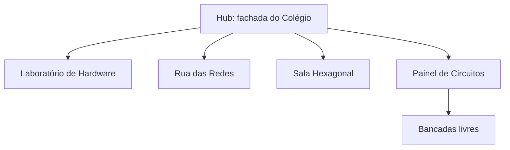

# Mapa e regiões

## Zonas

| Zona | Região WorldGuard | Inspiração | Trilha | NPC | Quem pode construir |
|---|---|---|---|---|---|
| Hub da fachada | `hub` | Colégio Donaduzzi | Boas-vindas | Bia | Administração |
| Laboratório de Hardware | `lab_hardware` | Laboratórios do Biopark | T1 | Prof. Byte | Administração |
| Rua das Redes | `rua_redes` | Área temática | T2 | Ana Rede | Administração |
| Sala Hexagonal | `sala_hex` | Sala da Faculdade Donaduzzi | T3 | Duda Docs | Administração |
| Painel de Circuitos | `painel` | Área temática | T4 | Téo Circuito | Administração |
| Bancadas livres | `bancadas` | Área temática | T4 | Téo Circuito | Alunos |

## Modelos das zonas

| Zona | Foto de referência | Elementos que identificam o local | Arquivo |
|---|---|---|---|
| Laboratório de Hardware | Laboratório com parede geométrica | Parede colorida, coluna azul, parede laranja, bancadas brancas e quadro | `trilha_t1_lab_hardware.schem` |
| Rua das Redes | Acesso lateral do Colégio | Ala amarela e branca, bancos, palmeiras e passarela de postes escuros | `trilha_t2_rua_redes.schem` |
| Sala Hexagonal | Sala da Faculdade Donaduzzi | Parede bordô, logo e frase, mesas hexagonais e janelas | `trilha_t3_sala_hexagonal.schem` |
| Painel de Circuitos | Laboratório com mesas de madeira | Parede azul, parede laranja, colunas amarelas e mesas de madeira | `trilha_t4_painel.schem` |

## Disposição sugerida

Deixe caminhos largos entre as zonas e placas em cada cruzamento.

## Coordenadas

Preencha depois de colar as construções.

| Região | Canto 1 (x y z) | Canto 2 (x y z) | Ponto do NPC (x y z) |
|---|---|---|---|
| `hub` | a preencher | a preencher | a preencher |
| `lab_hardware` | a preencher | a preencher | a preencher |
| `rua_redes` | a preencher | a preencher | a preencher |
| `sala_hex` | a preencher | a preencher | a preencher |
| `painel` | a preencher | a preencher | a preencher |
| `bancadas` | a preencher | a preencher | não se aplica |

## Medidas da fachada

As medidas foram ajustadas por retificação das fotos em `referencias/fotos/`.

| Elemento | Medida em blocos | Bloco |
|---|---|---|
| Portal | 48 de largura × 18 de altura | `white_concrete` |
| Pilares | 3 de largura; 4 de profundidade no chão e 6 no topo | `white_concrete` |
| Painel do letreiro | 42 × 5 | `blue_concrete` |
| Faixa branca sob o letreiro | 42 × 3 | `white_concrete` |
| Marquise | 42 × 1 | `blue_concrete` |
| Brise sobre as portas | 32 × 2 | `smooth_stone_slab` duplo |
| Portas e vidros | 4 de altura | `black_stained_glass_pane` e `white_concrete` |
| Alas | 14 de altura; amarelo até 8 e branco acima | `yellow_concrete` e `white_concrete` |
| Janelas das alas | Faixa de 2 de altura | `light_gray_stained_glass_pane` |
| Torre | 16 de altura, com caixa de vidro azul | `blue_stained_glass` |
| Calçada | 4 de largura | `terracotta` |

Comparado à foto com a mesma câmera, o modelo teve erro médio de 4,6 px em 7 pontos de referência.

### Simplificações

- As coberturas que aparecem em uma das fotos não foram modeladas.
- As emendas dos painéis de revestimento não aparecem.
- Portas não abrem, e não há interior atrás da fachada.
- Calçada, palmeiras e bancos têm posição aproximada.
